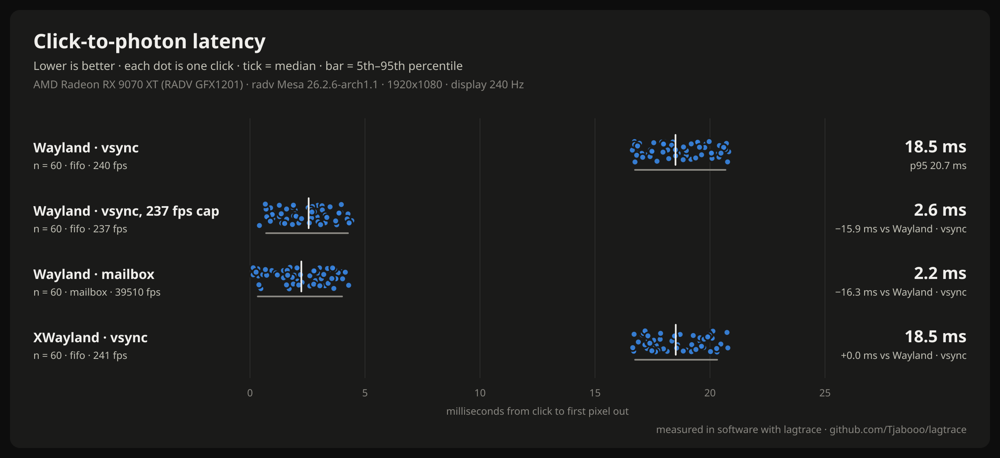

# lagtrace

[](https://github.com/Tjabooo/lagtrace/actions/workflows/ci.yml) [](https://github.com/Tjabooo/lagtrace/releases) [](LICENSE)

**Measure the input lag of any Linux game, in software.** No light sensor, no Arduino, no high-speed
camera: lagtrace clicks for you, watches the frames the GPU produces, and reports how long it took
from the click to the first pixel of the answer leaving for your monitor. Then it tells you whether
gamescope, XWayland, vsync, a frame cap or your compositor made it worse.



<sub>Example: `lagtrace suite --direct` on an RX 9070 XT (Mesa 26.2) and Hyprland, on a 240 Hz headless
output with the bench reading its input device directly. Each dot is one click. Run it on your
machine and post yours.</sub>

## Why

- The Linux "does X add input lag?" arguments (Wayland vs X11, gamescope, VRR, frame limiters) almost
  always run on feel. The few real measurements need a light sensor and a homemade rig.
- PresentMon and NVIDIA's PC Latency stats are Windows-only.
- lagtrace runs on any Vulkan game, including Proton/DXVK/VKD3D, with a normal mouse, on the machine
  you play on. You can repeat a test after every config change.

## Quick start

```sh
git clone https://github.com/Tjabooo/lagtrace.git && cd lagtrace
make && make install            # per user, into ~/.local; no root
sudo usermod -aG input "$USER"  # once, then log out and in (see Permissions)
lagtrace doctor                 # checks everything
lagtrace bench                  # 100 clicks on the built-in test app, about a minute
```

`lagtrace bench` opens a fullscreen test window that turns white while the mouse button is held.
Don't touch the mouse while it runs. Then (a 60-click run):

```
lagtrace · bench fifo · 60 clicks → 60 measured, 0 missed
  click to photon   median 18.8 ms   p5 16.9   p95 20.7   mean 18.7 ± 1.2
  where it went     click → present 2.2 ms · GPU 0.1 ms · compositor + display 16.6 ms   (medians)
  end point         first pixel out (VK_EXT_present_timing)
  frames            240 fps, display every 4.16 ms
  saved             ~/.local/share/lagtrace/results/2026-11-10_053300_bench-fifo.json
```

Try something else and compare:

```sh
lagtrace bench --present-mode mailbox
lagtrace bench --x11                       # through XWayland
lagtrace bench --x11 --present-mode mailbox
lagtrace bench --fps-cap 237 --present-mode mailbox
lagtrace compare --last 2 --png ab.png     # medians, 95% CI of the difference, a chart
```

`--direct` makes the bench read lagtrace's virtual gamepad straight from `/dev/input` instead of
getting the click from your compositor (the desktop never sees that device). Compare it with a normal
run and the difference is your compositor's input path. It also means `--direct` runs don't need
the window to have focus.

Or run the standard set and get one chart: `lagtrace suite` (Wayland with vsync, with vsync and an FPS
cap 3 under your refresh rate, and with mailbox, plus XWayland with vsync; about four minutes).

## Measuring a game

1. Start the game with the layer on. In Steam: **Properties → Launch Options**: `LAGTRACE=1 %command%`.
   Anything else: `LAGTRACE=1 yourgame`.
2. Get to a spot where a click changes something you can see, in the same place every time: firing a
   weapon in an offline practice map (muzzle flash, crosshair, ammo counter), opening a menu.
3. Tell lagtrace where to look, as fractions of the screen, and start it:

   ```sh
   lagtrace attach --probe 0.62,0.80,96 --clicks 100   # x, y, region size in pixels
   ```

   You get 5 seconds to switch to the game. lagtrace then clicks through its virtual mouse.
   `--manual` counts your own clicks instead.

Or let lagtrace start it: `lagtrace run --probe 0.5,0.5 -- ./game`.

> Only use automatic clicking in offline modes. Never run it in online matches with anti-cheat.

## What the numbers mean

```
click                 kernel timestamp of the button press (evdev)
  → click → present   the game notices it and submits the frame that shows it
  → GPU               the GPU finishes that frame
  → compositor+display  it waits in the swapchain queue, gets composited, waits for the vblank
first pixel out       the frame starts going out to the monitor (VK_EXT_present_timing)
```

Not included: your mouse's own delay (USB polling: ≤1 ms at 1000 Hz), your monitor's processing and
pixel response (see its review), and the scanline (a pixel in the middle of the screen appears about
half a refresh after the first one). The details, and checks you can repeat, are in
[docs/how-it-works.md](docs/how-it-works.md).

## Commands

| Command | What it does |
|---|---|
| `lagtrace bench [--present-mode M] [--x11] [--fps-cap N] [--load-ms MS] [--images N] [--direct] [--gamescope=ARGS]` | Measure the built-in test app |
| `lagtrace suite` | The standard set of bench runs (vsync, capped, mailbox, XWayland), one chart |
| `lagtrace run [opts] -- COMMAND` | Start any Vulkan program with the layer and measure it |
| `lagtrace attach [--pid PID]` | Measure a game that's already running with `LAGTRACE=1` |
| `lagtrace compare A.json B.json … \| --last N [--png F]` | Table, 95% CI of the median difference, Mann-Whitney test, chart |
| `lagtrace show RESULT.json [--png F]` | Summary and histogram of one run |
| `lagtrace list` | Your saved results |
| `lagtrace analyze LOG` | Re-analyze a raw layer log (each result keeps one as `.log.gz`) |
| `lagtrace doctor [--live]` | Check the setup; `--live` opens the bench for a second to test the layer |

Measuring options shared by `bench`, `run` and `attach`: `--clicks N` (100), `--interval MIN-MAX`
(350-650 ms between clicks, random), `--hold MS` (120), `--warmup S`, `--probe X,Y[,SIZE]`,
`--threshold` (luma change that counts, 8 of 255), `--manual`, `--label`, `-o FILE`, `--keep-open`.

## Install

You need a C compiler, `make`, SDL3, the Vulkan loader and headers, and Python 3.9+. No Python packages.

| Distro | Packages |
|---|---|
| Arch | `sudo pacman -S --needed base-devel sdl3 vulkan-headers vulkan-icd-loader python` |
| Fedora | `sudo dnf install gcc make SDL3-devel vulkan-headers vulkan-loader-devel python3` |
| Debian / Ubuntu | `sudo apt install build-essential libsdl3-dev libvulkan-dev python3` |

The layer needs Vulkan headers from 1.4.330 or newer (for `VK_EXT_present_timing`). If yours are older,
`make deps` fetches them into `deps/` and the build uses them. Without SDL3, `make NO_BENCH=1` builds
only the layer and the CLI. Optional: `librsvg` (or ImageMagick) for PNG charts, `vulkan-tools` for
`doctor`'s driver check, `gamescope`.

`make install` puts everything under `~/.local` (`PREFIX=/usr` for a system install;
`packaging/aur/PKGBUILD` does that). `make uninstall` removes it. Running from the checkout
(`python3 -m lagtrace`) works too, without installing.

### Permissions

- **Click times** come from `/dev/input/event*`, which needs your user in the `input` group:
  `sudo usermod -aG input "$USER"`, then log in again. Be aware that this lets any program you run
  read your keyboard. The layer only looks at *when* keys and buttons go down, never which keys.
- **Automatic clicks** go through `/dev/uinput`. If `lagtrace doctor` says it can't write there:

  ```sh
  echo 'KERNEL=="uinput", GROUP="input", MODE="0660"' | sudo tee /etc/udev/rules.d/60-uinput.rules
  sudo udevadm control --reload && sudo udevadm trigger /dev/uinput
  ```

### Drivers

lagtrace reads the display time from `VK_EXT_present_timing`. Mesa 26.2 has it (tested on RADV). On
drivers without it, or compositors that don't report presentation times, the end point becomes "GPU
done", which leaves out the swapchain queue and the compositor. lagtrace says so in every result.

## Configuration

The layer reads these (set them in front of the game, or let the CLI set them):

| Variable | Default | |
|---|---|---|
| `LAGTRACE` | | `1` loads the layer |
| `DISABLE_LAGTRACE` | | `1` keeps it out even when `LAGTRACE=1` |
| `LAGTRACE_PROBE` | `0.5,0.5,64` | probe centre (fractions of the frame) and size in pixels |
| `LAGTRACE_WINDOW_MS` | `300` | how long after a press frames are logged |
| `LAGTRACE_LOG` | `/dev/shm/lagtrace-<uid>/<pid>.log` | log path (`%p` = pid) |
| `LAGTRACE_DEVICES` | all | only watch input devices whose name contains one of these (comma-separated) |
| `LAGTRACE_NO_TIMING` | | `1` skips display timing (end point = GPU done) |
| `LAGTRACE_DEBUG` | | `1` prints what the layer does to stderr |

Results go to `~/.local/share/lagtrace/results/` as JSON (every sample, the setup, the summary) with
the raw log next to each one.

## How it works

The Vulkan layer copies a 64×64 probe of every presented frame into CPU-readable memory, behind the
game's own rendering, and logs it with kernel click timestamps and the driver's display times. The CLI
finds the first frame after each click whose probe changed, and the first frame at or after it that
reached the display. The full story, the log format and the accuracy checks are in
[docs/how-it-works.md](docs/how-it-works.md).

**Cost:** about 13 µs of CPU per frame (one small copy and one extra queue submission). The game never
waits on the GPU because of it.

## Limitations

- Vulkan only. That includes DXVK and VKD3D-Proton, so almost every Proton game; native OpenGL games
  aren't covered. 64-bit only.
- Programs that present to several windows at once are measured on one.
- **gamescope:** inside a gamescope *session* (Steam Deck, SteamOS, gamescope-session on the DRM
  backend) the display times are gamescope's real flips. A *nested* gamescope (a window on your
  desktop) hands its frames to your compositor without a Vulkan swapchain, so lagtrace can only measure
  up to gamescope's own present: your desktop's compositing after it isn't included, and lagtrace says
  so. Compare nested gamescope runs with each other, not with runs outside it.
- Tested on AMD (RADV) with Hyprland and gamescope. Reports from Intel, NVIDIA, KDE and GNOME are welcome.

## Contributing

Issues and PRs are welcome. The most useful things right now:

- **A photodiode comparison.** If you own an LDAT, OSLTT or a DIY light-sensor rig, measure the same
  setup with both and open an issue with the numbers.
- **Results from other GPUs, drivers and desktops.** `lagtrace suite`, then attach the PNG and the
  JSON files.
- **Probe presets for games** (where to look for the muzzle flash in game X).

Run the tests with `make test`.

## License

MIT
